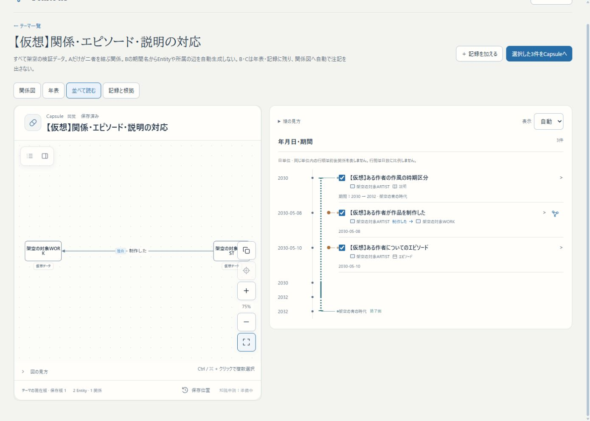
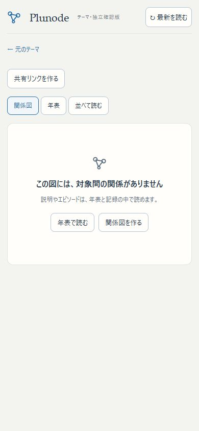

# テーマ・年表・関係図の表示分離（2026-11-01）

## 確認先と起動

- [関係・説明・エピソードの混在テーマ](http://localhost:3276/themes/pattern-record-context-1a8007b0)：仮想3記録。関係図は2対象・1関係、年表は3件。「並べて読む」で比較する。関係図への入口は関係行にだけ表示する。
- [説明とエピソードだけのCapsule](http://localhost:3276/themes/capsules/a0199be4-9739-4683-af2e-8fcb219cbb1d)：年表から開く。「関係図」で空の理由を表示し、年表へ戻る／空の図を作る操作ができる。
- [旧図を整理した私有Capsule](http://localhost:3276/themes/capsules/19d58e53-8afe-495a-9f68-227aaf70dc2c)：作者の手動注記は残る。「整理前の図に戻す」で、次の図編集保存・訂正取込まで戻せる。
- [同じURLへ反映した共有版](http://localhost:3276/themes/shared/EvR8Cn-6ic_CbieHg0qLq8leHbNF8qsb)：現在は保存版5。取り消し用文書・編集操作を公開しない。

独立worktree `/home/isinxnisi/1.projects/.worktrees/graph-issue75-theme-foundation` から `python3 scripts/issue75-preview.py status`、停止していれば `python3 scripts/issue75-preview.py start`。再buildが必要なら同スクリプトの `stop` → `build` → `start`。専用PostgreSQL `plunode-issue75-postgres` / `plunode_theme75`、Web3276・DB55475の既存データを再利用する。Node24・Docker・既存private runtimeが前提。認証・会員DB・KG接続は利用しない。

実行build: `OGosgFVyPxKDiIpI5qzHc`。作業ブランチは `codex/issue75-theme-foundation`。main・3200・HTTPS β・本番への統合／配置は今回の依頼範囲外として実施していない。

## 判断と変更

テーマは根拠付き記録を束ねる単位、年表と関係図はその異なる表示である。現行UIがテーマ単位の既定年表を開くことと、両者を同一の存在にすることは別。複数軸・選択断面を保ち、任意の名前付き年表を複数管理するUIはまだない。

以前は全記録を既存Capsule文書へ変換する際、episode/noteも自由テキストと対象説明に自動コピーしていた。年表上の説明を一律に関係図へ載せるUX上の根拠はなく、投影の実装上の都合だった。この既定を変更し、関係図への自動出力を明示したrelationと必要な両端・その根拠に限定した。

説明・エピソードは原記録／年表／検索／訂正／Capsule断面へ残る。期間名だけからEntityや所属関係を作らない。図の作者が手で追加した注記、対象の固有説明、明示された分類関係などは通常どおり表現できる。「関係図で説明を使うこと自体が常に不自然」という一律禁止ではない。

旧保存図と共有版は閲覧だけで変えない。所有者の明示整理で、保存時生成値と一致する自動注記・対象の自動説明・その根拠コピーだけを図から外す。文面・書式・位置を編集した注記、手動要素、配置、原記録を保持する。取り消し文書は私有保存に限り、共有コピーへ含めない。整理／取り消しでは共有先を更新せず、既存の明示反映操作を使う。

## 検証

- Vitest 7ファイル **109件成功**。関係だけの投影、空の投影、検索用原文、変更済み注記／位置／説明／根拠の保護、旧形式の識別、冪等な整理、既存年表の表示・対応など。
- ESLint成功。Next webpack build＋TypeScript検査成功。
- 実行中APIの通常入力経路で、基本操作 **17件**、時間意味・訂正・共有 **21件** 成功。API修正用のテストテーマだけを追加し、試験共有は停止した。
- 全13テーマの実データを読み取り、relation数＝関係図の辺数、必要な端点だけを投影、説明の自動注記0、関係だけの根拠コピーを確認。
- 実Chromeで新しい混在ケースを通常取込し、3記録から新Capsuleを作成。年表3件・図2対象1関係・自動注記0。説明とエピソードだけでもCapsuleを作成し、年表2件・図0件。空の図を編集開始して破棄し、保存版1のままであることを確認。
- **旧アプリで作った追加の検証Capsule**に、作者の手動注記を通常UIで加えて保存版2を共有。新アプリで整理3 → 元へ戻す4 → 再整理5 → 共有へ反映5を実操作。手動注記／配置／原断面を保持し、戻すとdocument/sourceDocumentが整理前と完全一致。共有は明示反映まで版2のまま、反映後も同URL。繰返し整理400・古い版への復元409は状態を変更しない。
- PC1400×1000、スマホ幅390×844で横はみ出しなし。年表のみのCapsuleは年表から開き、存在しない図への移動を出さない。空の図には年表へ戻る／図を作る導線を表示。確認タブのwarn/errorは0、viewport上書きは解除済み。
- 変更前の10テーマ・8Capsule・7共有コピーは、全件の正規化SHA-256が一致。private dumpもhash一致で保持。追加後13テーマ・14Capsule・8共有。migrationは不要。

検証資材：`docs/research/issue75-themes/view-separation-{core-http,time-http,projection-http,share-checks,browser,preservation}.json`。旧実装の文書fixtureは `tests/fixtures/theme-legacy-supporting-graph.json`。テスト原本dump・取り消し前後のprivate全文は `.local/issue75/` に保持し、commitしない。

## 残る範囲

独立確認版のため、会員認証・正式Capsule DBや本番共有への適用は未実施。実iPhone/WebKitでの再検証はしていない。複数の任意年表を独立管理するUI、対象を持たない全体注記、原記録と作者の独自図の外見同期、時刻・timezoneなどは従来の後続範囲のまま。関係図の注記をレコードごとに任意投影する設定を増やしたものではなく、通常の図編集で注記を加えられる。

旧図の孤立した対象ノードは作者の構図を守るため整理時に勝手に消さない。文面等を編集した自動注記も保持する。年表の期間名と分類Entityを同一視せず、資料が明示する分類関係は残す。
